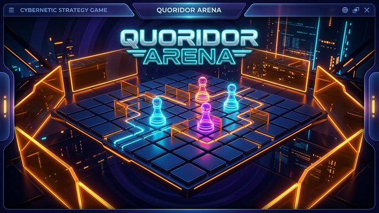

# 🏰 Quoridor Telegram Bot & Realtime Mini App

A full-stack, production-ready **Telegram Quoridor 1v1 Arena & Bot** built with **TypeScript**, **grammY**, **Vite**, and an optimized 8×8 Quoridor game engine. Supports real-time multiplayer via Server-Sent Events (SSE), ranked Elo ladder with SVG/Canvas profile cards, unrated AI Bot matches, Threefold repetition draw detection, mutual draw agreements, spectator seats, and 720p match replay rendering.



---

## 🌟 Key Features

- **🎮 Realtime 1v1 Multiplayer Mini App**:
  - Seamless matchmaking via Telegram Inline query (`@your_bot` in any chat).
  - Low-latency board synchronization via Server-Sent Events (SSE).
  - Versioned room state sync with monotonic sequence validation.
  - Spectator mode with live pawn & wall placement observation.
  - Instant Rematch flow, Resign dialogs, and Cancel Match before moves begin.
- **🤖 Play vs Bot (Medium AI)**:
  - Accessible directly from `/newgame` or `/start`.
  - Multi-threaded worker pool utilizing BFS pathfinding and minimax evaluation.
  - Bot games are strictly unrated (never affects player Elo ratings).
- **🏆 Ranked Elo Rating System**:
  - Starting rating: 1000 ELO with K-factor scaling and win streak bonuses.
  - 6 distinct rating tiers: Yellow (1000), Blue (1150), Brown (1300), Green (1500), Red (1700), Violet (1900+).
  - Dynamic 720p gradient user profile cards generated on demand.
  - Global Top Duelists leaderboard and paginated match history.
- **⚖️ Competitive Rules & Draws**:
  - Full official 8×8 Quoridor rules (straight jumps, diagonal bypass jumps, wall placement validation).
  - **Threefold Repetition**: Automatic server-side draw detection when identical pawn + wall positions repeat 3 times.
  - **Mutual Draw Offer & Accept**: Interactive draw dialogs with cancel and decline protections.
- **🎞️ 720p Video Replays & Move Notation**:
  - Step-by-step game notation viewer.
  - Background FFmpeg rendering queue for animated 720p MP4/GIF replays.

---

## 📁 Repository Structure

```
.
├── quoridor-bot/               # Backend Server & Telegram Bot
│   ├── src/
│   │   ├── bot/                # grammY bot commands, inline query, and UI
│   │   ├── db/                 # Database schema and persistence layer
│   │   ├── engine/             # Quoridor rules engine, bot AI, and Elo math
│   │   ├── render/             # FFmpeg video generator and profile card renderer
│   │   ├── workers/            # Worker thread pool for engine calculations
│   │   ├── rooms.ts            # Server-Sent Events (SSE) live room state manager
│   │   └── index.ts            # Application HTTP entrypoint and bot poller
│   ├── migrations/             # SQL schema migrations
│   ├── Dockerfile              # Docker container definition
│   ├── docker-compose.yml      # Local stack orchestration
│   └── package.json
│
├── quoridor-miniapp/           # Frontend Telegram Mini App (Web)
│   ├── src/
│   │   ├── audio.ts            # Interactive sound effects (Web Audio API)
│   │   ├── engine.ts           # Client-side move validation & visual hints
│   │   ├── telegram.ts         # Telegram WebApp SDK integrations
│   │   ├── style.css           # Premium glassmorphism UI styles
│   │   └── main.ts             # Main game controller & UI bindings
│   ├── index.html              # Mini App HTML structure
│   └── vite.config.ts          # Vite build configuration
│
├── assets/                     # Preview media and illustrations
├── .env.example                # Template configuration file
├── .gitignore                  # Git ignore rules
└── package.json                # Root build orchestration
```

---

## 🚀 Quick Start

### 1. Prerequisites
- **Node.js**: v18.0.0 or higher
- **npm**: v9.0.0 or higher
- **FFmpeg**: (Optional, required only for video replay rendering)

### 2. Configure Telegram Bot via @BotFather
1. Open [@BotFather](https://t.me/BotFather) on Telegram and create a new bot with `/newbot`.
2. Enable **Inline Mode** for multiplayer invites:
   - Send `/setinline` ➔ Choose your bot ➔ Provide placeholder (e.g. `Play 1v1 Quoridor`).
   - Send `/setinlinefeedback` ➔ Choose your bot ➔ Select `Enabled (100%)`.
3. Create your **Mini App**:
   - Send `/newapp` ➔ Choose your bot ➔ Set title and description.
   - Choose a short name (e.g. `quoridor`).
   - Set the Web App URL to your deployed frontend HTTPS URL (or active Cloudflare tunnel).
4. Set the **Menu Button**:
   - `/mybots` ➔ Select your bot ➔ `Bot Settings` ➔ `Menu Button` ➔ `Configure menu button` ➔ Enter your Mini App HTTPS URL.

### 3. Environment Setup
Copy the environment template and fill in your secrets:

```bash
cp .env.example quoridor-bot/.env
```

Edit `quoridor-bot/.env`:
```env
BOT_TOKEN=123456789:ABCdefGhIJKlmNoPQRsTUVwxyZ
BOT_USERNAME=@your_bot_username
PUBLIC_BOT_USERNAME=@your_bot_username
WEBAPP_URL=https://your-domain.com
MINIAPP_SHORT_NAME=quoridor
PORT=3000
```

### 4. Install & Build

Install dependencies and build both projects from the root:

```bash
# Build frontend and backend
npm run build
```

Or build individually:
```bash
# Backend build
cd quoridor-bot && npm install && npm run build

# Frontend build
cd ../quoridor-miniapp && npm install && npm run build
```

### 5. Running

Start the server & bot:
```bash
cd quoridor-bot
npm start
```

---

## 🐳 Docker Deployment

A production-ready `Dockerfile` and `docker-compose.yml` are provided in `quoridor-bot/`:

```bash
cd quoridor-bot
docker compose up -d --build
```

---

## 📜 Quoridor Game Rules

- **Board**: 8×8 grid. Player 1 starts at the bottom row (row 1); Player 2 starts at the top row (row 8).
- **Objective**: The first player whose pawn reaches any cell on the opponent's starting row wins!
- **Turns**: On each turn, a player may either:
  1. **Move Pawn**: 1 step orthogonally (Up, Down, Left, Right). If facing the opponent pawn directly with no wall behind them, they can execute a **straight jump** over the opponent. If a wall blocks the jump, they can make a **diagonal bypass jump**.
  2. **Place Wall**: Each player begins with 8 walls. Walls block movement between cells. A wall cannot completely seal off any player from reaching their goal row.
- **Draws**:
  - Threefold repetition (same pawn positions and remaining walls repeated 3 times).
  - Mutual agreement through the in-game Draw button.

---

## 🛡️ License

MIT License. Crafted with ❤️ for Telegram gaming.
